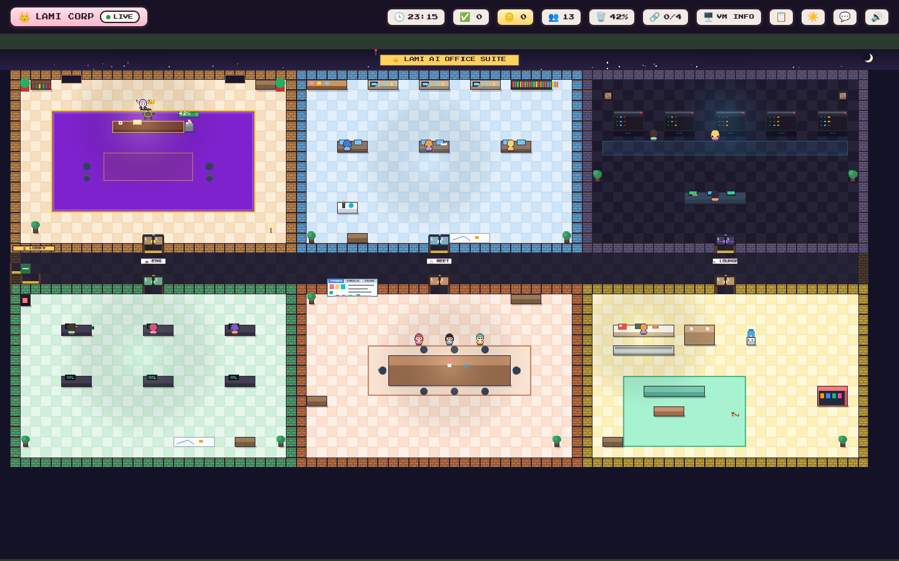
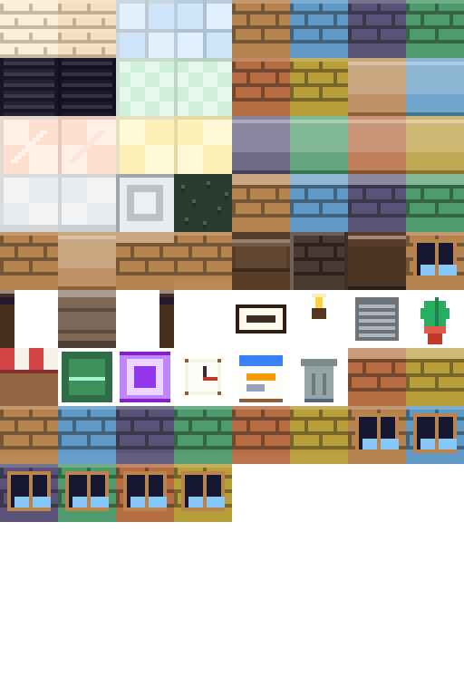

# Lami AI Office



A pixel-art office where AI agents visibly work. The office is a **server-authoritative
simulation**: one shared world runs at 10 Hz on the server, every browser renders the
same frames over SSE, and the floor keeps living when nobody is watching.

Live: <https://office.fatihrumi.id>

```
Python stdlib only · vanilla JS, no build step · 378 tests · zero runtime dependencies
```

## What it does

- **One office, many viewers.** `world.py` owns every character's position. Browsers
  receive `world` frames and interpolate; they never simulate independently, so two
  visitors never see different floors.
- **Live from Hermes.** A bridge on each agent host tails the Hermes transcript and
  POSTs office events. Agents wake, walk to their desk, use tools, talk, and leave.
- **Honest status.** The HUD reports `live` / `slow` / `idle` from the real age of the
  last event. It does not claim to be busy when nothing is happening.
- **Public chat.** Visitors can talk to Lami, rate-limited per IP with a daily budget.
  The message is tagged untrusted and the agent answers read-only.

## Quick start

Docker is the supported path. The image is ~120 MB and needs no runtime install.

```bash
cp .env.example .env.production          # then fill in the secrets you need
docker compose --env-file .env.production up -d --build
curl -s localhost:8090/healthz
```

Open <http://localhost:8090>. Add `?demo=1` to run the office without a server stream,
`?vertical=1` for 9:16 framing.

Running `server.py` directly also works (Python 3.11+, no `pip install`):

```bash
python3 server.py            # serves web/ and the SSE stream on :8090
python3 server.py --probe    # print which Hermes data this host can see
```

## Commands

Everything has two entry points. `make` and `npm` run the same scripts; use whichever
is installed.

| Task | make | npm |
|---|---|---|
| Full test suite (378) | `make test` | `npm test` |
| One tier (`1`–`4`) | `make test-tier1` | `npm run test:tier1` |
| Syntax check all JS | `make syntax` | `npm run syntax` |
| `world.py` vs `config.js` | `make guard` | `npm run guard` |
| Verify committed assets | `make assets-check` | `npm run assets:check` |
| Regenerate assets | `make assets` | `npm run assets` |
| Probe a live deploy | `make smoke HOST=… PORT=…` | `npm run smoke` |
| **Everything CI runs** | **`make check`** | — |

`make check` is the gate: syntax, world-sync guard, asset hashes, then 378 tests.

## Layout

```
server.py          stdlib HTTP + SSE, public chat proxy, A2A client
world.py           the simulation: floorplan, A*, collision, characters, routines
config.json        optional overrides (env vars win)
web/               index.html, css/style.css, js/*.js (11 files), assets/
deploy/agent/      bridge, hook, metrics agent, systemd units  → runs on .31, .91-.94
deploy/office/     cloudflared tunnel config                    → runs on .33
scripts/assets/    tileset + tilemap generators, hash stamper, world-sync guard
scripts/ops/       deploy_prod, deploy_staging, push_to_github, smoke_test
tests/             zero-dependency harness + 378 tests in four tiers
docs/              ARCHITECTURE, TESTING, SECURITY, CI, CHANGELOG
```

There are no hidden modules: `server.py` (2,087 lines) and `world.py` (2,205) are
single files by choice, with segment separators. See
[docs/ARCHITECTURE.md](docs/ARCHITECTURE.md#why-serverpy-is-one-file) for the reasoning —
splitting them would break 11 assertions that grep specific blocks.

### Assets are generated, not drawn

The floor, walls, doors, windows and props are all tiles. 67 of them, in one
128×192 spritesheet, produced by a Python script from the floorplan in
`web/js/config.js`. The same script emits the tilemap, so a wall cannot end up
somewhere the collision grid does not expect it.

<p align="center">
  
  <br>
  <sub><code>web/assets/tiles/tileset.png</code>, shown at 4× — every room gets its own wall palette</sub>
</p>

`make assets-check` fails if the committed PNG, JSON or `?v=` hashes drift from
`config.js`, so the artefacts can never quietly disagree with the plan.

## How the pieces talk

```
Hermes host (.31/.91-.94)          Office host (.33)              Browser
┌──────────────────────┐        ┌────────────────────┐        ┌──────────┐
│ hermes_bridge.py     │──POST─▶│ /api/event         │        │          │
│  (tails state.db)    │        │        │           │        │          │
│                      │        │     Hub.publish    │        │          │
│ metrics_agent.py     │◀──poll─│ A2ARegistry        │        │          │
│  (:8010 /proc)       │        │        │           │        │          │
└──────────────────────┘        │   world.py @ 10 Hz │        │          │
                                │        │           │──SSE──▶│ render   │
┌──────────────────────┐        │   world frames     │        │ only     │
│ A2A sidecars         │◀──A2A──│   ~5 Hz            │        │          │
│  (Yuna, Aurora,      │        │                    │◀─POST──│ /api/chat│
│   Kira, Cyro)        │        └────────────────────┘        └──────────┘
└──────────────────────┘
```

Full interface contracts, the floorplan, and deployment details are in
[docs/ARCHITECTURE.md](docs/ARCHITECTURE.md).

## Configuration

Two axes, both set per environment file.

**Public vs LAN.** `PUBLIC_MODE=live` serves real activity to tunnel visitors;
`demo` gives them a local simulation and refuses `/events`. LAN clients are always
treated as trusted and may POST ingest events and drive A2A peers.

**Profiles.** `.env.production` (project `office-prod`, ports 8088/8090) and
`.env.development` (project `office-dev`, ports 18088/13579). Secrets live in
`.env.production.secrets` / `.env.development.secrets`, which are gitignored — compose
is always invoked with both files:

```bash
docker compose --env-file .env.production --env-file .env.production.secrets up -d --build
```

Chat guardrails (`CHAT_PER_MINUTE`, `CHAT_PER_HOUR`, `CHAT_DAILY_CAP`, `CHAT_MAX_CHARS`)
are documented in `.env.example`. Without `CHAT_ASK_URL` pointing at the Hermes shim,
chat falls back to raw A2A, which the gateway rejects with 401.

## Testing

378 tests, zero frameworks, ~80 s. Four tiers plus a world-parity suite:

| Tier | What it covers |
|---|---|
| 1 | Every documented feature, including server↔client world parity |
| 2 | Boundary cases: 0×0 viewports, obstacle traps, body limits, auth matrix |
| 3 | Cross-feature: pathfinding through doors, drawer + resize, modal conflicts |
| 4 | Real HTTP against a real `server.py` subprocess: SSE fan-out, A2A stubs, restart persistence |

Layout and how to add a test: [docs/TESTING.md](docs/TESTING.md).

## Deployment

Production is a mirror of `master`; nobody edits code on that host.

```bash
make deploy-prod                                    # fast-forward + rebuild + health wait
HOST=192.168.3.33 PORT=8090 make smoke              # 6 probes, exit code is the verdict
```
Staging mirrors `dev` on `.32` and is the only place that runs untagged code.
Branch rules and the release procedure:
[docs/ARCHITECTURE.md](docs/ARCHITECTURE.md#deployment-production).

### The bridge target pitfall

The bridge makes the office real-time, and it can be aimed at the wrong office.
This shipped as a real bug once: the bridge pointed at staging, so production
looked permanently idle while agents were working.

```bash
# which office gets fed — check this before enabling the bridge
OFFICE_URL=http://192.168.3.33:8090      # production
# OFFICE_URL=http://192.168.3.32:13579   # staging
```

Diagnose it with the event age, not with a glance at the floor:

```bash
curl -s http://192.168.3.33:8090/api/integration | jq .last_event_age_s
systemctl --user status hermes-bridge
```

If `last_event_age_s` keeps growing while agents are working, the bridge is
aimed somewhere else. `watcher.stale: true` in the same payload means the
mounted Hermes home has no fresh activity and the cross-host bridge (or
`POST /api/event`) is the active path.

## Security

Public traffic cannot ingest events or drive peers; both paths check
`is_public()` before anything else. Secrets are uncommitted, text leaving the process
is redacted, and the event schema is an allow-list. Known gaps — including a rotated
token still present in `master`'s git history — are listed honestly in
[docs/SECURITY.md](docs/SECURITY.md).

## License

No license file yet. Treat this as all-rights-reserved until one is added.
